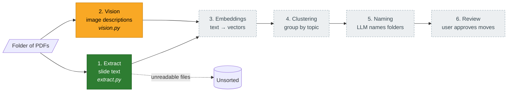

# Folio

Sorts a messy folder of PDFs and slide decks into named topic folders.

**Team:** Rayyan Arshad, Nayeel Suleman · CSCE 289, Fall 2026

## The problem

Most students have a downloads folder full of unsorted PDFs and slide decks that piles up faster than anyone organizes it. Filename search misses anything that wasn't named well in the first place.

## Why GenAI

Keyword search can't group documents by what they're about. A slide deck on backpropagation and a PDF on gradient descent belong together even if they share no keywords. Embeddings capture that meaning, and an LLM can look at a group of documents and write a folder name a person would actually use.

**Input:** a folder of unsorted documents (for the demo, lecture PDFs and slide decks from this semester).
**Output:** the same files sorted into named topic folders, e.g. `Embeddings & Retrieval`, `Prompt Engineering`, `Agents`.

## Approach



🟩 done · 🟨 in progress · ⬜ planned

| Step | What it does | Module | Status |
|---|---|---|---|
| 1 | Extract text from each PDF, one chunk per slide | `folio/extract.py` | ✅ |
| 2 | Describe the images on each slide with a vision model (Gemini) | `folio/vision.py` | ✅ |
| 4 | Cluster documents by topic | `folio/cluster.py` | planned |
| 5 | Have an LLM name each cluster | `folio/name.py` | In progress (Rayyan) |
| 6 | Propose the folders and let the user review them before files move | — | planned |

## Setup

```bash
python -m venv .venv
.venv\Scripts\activate          # Windows  (macOS/Linux: source .venv/bin/activate)
pip install -r requirements.txt
setx GEMINI_API_KEY "your-key"   # free key from aistudio.google.com, then reopen the terminal
python -m folio.vision
```

This describes the first image in `data/sample/class17-images.pdf` with Gemini and prints the prompt, the input, and the output.

## What could go wrong

- The LLM invents folder names that sound good but don't match the files.
- Topics split or merge differently from run to run.
- Embeddings cluster by **template** rather than topic. Every CSCE 289 deck opens with the same title slide and "Questions / Comments / Concerns?", which could make all the lectures look alike regardless of subject.
- Scale: good results on 20–30 files don't guarantee good results on thousands.

## Test cases

See [`tests/READ_TESTS.md`](tests/READ_TESTS.md) for the test cases, how to run them, how results are scored, and which ones pass so far.
