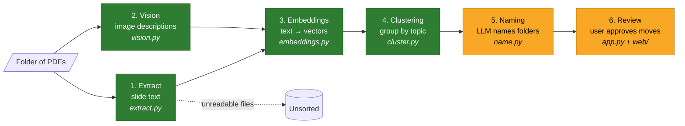

# Folio

Sorts a messy folder of PDFs and slide decks into named topic folders.

**Team:** Rayyan Arshad, Nayeel Suleman · CSCE 289, Fall 2026

## The problem

Most students have a downloads folder full of unsorted PDFs and slide decks that piles up faster than anyone organizes it. Filename search misses anything that wasn't named well in the first place.

## Why GenAI

Keyword search can't group documents by what they're about. A slide deck on backpropagation and a PDF on gradient descent belong together even if they share no keywords. Embeddings capture that meaning, and an LLM can look at a group of documents and write a folder name a person would actually use.

**Input:** a folder of unsorted documents (for the demo, lecture PDFs and slide decks from this semester).
**Output:** the same files sorted into named topic folders, e.g. `Embeddings & Retrieval`, `Prompt Engineering`, `Agents`.

## Approach



🟩 done · 🟨 in progress · ⬜ planned

| Step | What it does | Module | Status |
|---|---|---|---|
| 1 | Extract text from each PDF, one chunk per slide | `folio/extract.py` | ✅ |
| 2 | Describe the images on each slide with a vision model (Gemini) | `folio/vision.py` | ✅ |
| 3 | Embed each document's chunks with `all-MiniLM-L6-v2` and average them into one vector per document | `folio/embeddings.py` | ✅ |
| 4 | Cluster documents by topic (agglomerative clustering, cosine distance threshold 0.35) | `folio/cluster.py` | ✅ |
| 5 | Have an LLM name each cluster | `folio/name.py` | In progress (Rayyan): `profile_document()` done, `name_clusters()` not written yet |
| 6 | Propose the folders and let the user review them before files move | `app.py`, `web/` | In progress: Flask app works end to end, but still groups by a stand-in until steps 3–5 are wired into `pipeline.py` |

**Results on `data/sample` (slide text only):** the two retrieval lectures have cosine similarity 0.86. Every other pair is 0.37–0.51. Clustering puts them in one folder and leaves the agents and images lectures in their own folders.

**Next:** write `name_clusters()`, then replace the stand-in `propose_folders()` in `pipeline.py` with `embed_documents` → `cluster_documents` → `name_clusters`.

## Setup

```bash
python -m venv .venv
.venv\Scripts\activate          # Windows  (macOS/Linux: source .venv/bin/activate)
pip install -r requirements.txt
setx GEMINI_API_KEY "your-key"   # free key from aistudio.google.com, then reopen the terminal
```

Without a Gemini key, Folio still runs, but it sorts using slide text only.

## Using the app

```bash
python app.py
```

Then open http://127.0.0.1:5000 in your browser.

1. **Choose files.** Drag PDFs onto the drop zone, or click it to choose several at once. Then click **Sort these files**.
2. **Review the proposed folders.** Click a folder's name to rename it. Use the dropdown next to a file to move it to another folder. **+ New folder** adds an empty folder. Files Folio couldn't read are listed under Unsorted.
3. **Approve.** **Approve and download ZIP** gives you a copy of the files sorted into your folders. Nothing on your own disk is moved or changed.

The first run on a new deck takes about 20 seconds while Gemini describes its figures. Decks Folio has already seen are cached and load instantly.

## Running steps on their own

Each step can be run by itself on the files in `data/sample/`:

```bash
python -m folio.vision       # describe the first image in class17-images.pdf
python -m folio.embeddings   # similarity matrix between the sample decks
python -m folio.cluster      # which sample decks end up in the same folder
```

## What could go wrong

- The LLM invents folder names that sound good but don't match the files.
- Topics split or merge differently from run to run.
- Embeddings cluster by **template** rather than topic. Every CSCE 289 deck opens with the same title slide and "Questions / Comments / Concerns?", which could make all the lectures look alike regardless of subject.
- Scale: good results on 20–30 files don't guarantee good results on thousands.

## Test cases

See [`tests/READ_TESTS.md`](tests/READ_TESTS.md) for the test cases, how to run them, how results are scored, and which ones pass so far.
